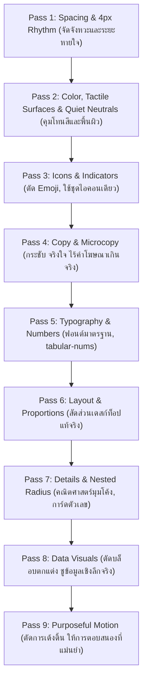

# Universal Modern UI Data Table & Anti AI-Slop System

คู่มือมาตรฐานสากลสำหรับการออกแบบและพัฒนาหน้าแสดงผลข้อมูลหนาแน่น (Data-Dense Pages), ตารางข้อมูล (Data Tables), และระบบจัดการข้อมูล (Data Management Views) สำหรับทุกโมดูลในระบบ โดยผสานหลักการ **Anti AI-Slop Craftsmanship ($unslop)** เข้ากับ **โครงสร้างยืดหยุ่น ไร้ค่าคงที่ตายตัว ปรับตัวตามบริบทข้อมูล (Context-Adaptive)**

---

## 1. ปรัชญา Anti AI-Slop สำหรับหน้าข้อมูลหนาแน่น (Core Philosophy)

> **"Slop spreads color and effects over the chrome. Craft keeps the chrome quiet and puts richness into the data itself."**
> (งาน AI Slop มักสาดสี แสงฟุ้ง และลูกเล่นลงบนกรอบและปุ่ม แต่งานระดับมืออาชีพจะทำกรอบให้เงียบสงบ แล้วส่งพลังทั้งหมดไปที่ความชัดเจนของตัวข้อมูลจริง)

1. **Quiet Chrome, Rich Content:** แถบนำทาง แถบเครื่องมือ กรอบตาราง และปุ่มควบคุม ต้องใช้สีกลาง (Neutral Ramp) และสีเน้น (Accent) เพียงจุดเดียว ไม่ใช้แสง Glow, ไม่ไล่สีจัดจ้าน (Gradient Wash), ไม่สาดไอคอนลูกกวาด เพื่อให้ผู้ใช้งานมองเห็นและวิเคราะห์ข้อมูลได้หลายชั่วโมงโดยไม่ล้าสายตา
2. **Context-Driven & Zero Hardcoding:** ทุกข้อความ ปุ่ม ตัวกรอง และคอลัมน์ ปรับตามเป้าหมายของหน้านั้น (Job-to-be-Done) ไม่บังคับชื่อตายตัว
3. **Progressive Disclosure:** แบ่งชั้นข้อมูลตามความสำคัญ:
   - **P1 (Critical):** รหัสประจำตัวและสถานะหลัก ตรึงไว้ให้เห็นเสมอ
   - **P2 (Operational):** ข้อมูลบริบทที่ใช้งานเป็นประจำ แสดงเป็นค่าเริ่มต้น
   - **P3 (Deep Metadata):** รายละเอียดเชิงลึก ซ่อนในเมนูเลือกคอลัมน์ หรือเปิดดูผ่าน Drawer / Modal
4. **Data Craft & Numerical Precision:** ตัวเลขทุกตัวจัดชิดขวา ใช้ฟอนต์ `tabular-nums` วันที่และสกุลเงินจัดฟอร์แมตสม่ำเสมอทั้งตาราง
5. **Restraint & Purposeful Motion:** เคลื่อนไหวเมื่อมีหน้าที่ (150–200ms) ปราศจากแอนิเมชันเด้งดิ้นหรือแสงกะพริบที่ไร้ความหมาย

---

## 2. กระบวนการ 9 Passes (Anti-Slop Redline Workflow)

เมื่อต้องออกแบบหน้าใหม่ หรือปรับปรุง (Refactor) หน้าเดิม ให้ดำเนินการตามลำดับ 9 ขั้นตอนนี้ ห้ามข้ามขั้น:



---

### Pass 1: Spacing & Alignment (จังหวะ 4px และการจัดแนวอย่างแม่นยำ)
- **สเกล 4px:** ทุก Margin, Padding, Gap และความสูง ต้องหาร 4 ลงตัว (`4, 8, 12, 16, 20, 24, 32, 48px`) กำจัดค่าเศษแปลกปลอม เช่น `py-[11px]`, `mt-[13px]`, `gap-[7px]` ออกทั้งหมด
- **Proximity Rule:** ระยะห่างภายในกลุ่มข้อมูลต้องเล็กกว่าระยะห่างระหว่างกลุ่มเสมอ (เช่น ระยะห่างระหว่างเซลล์ในแถว < ช่องว่างระหว่างกลุ่มตัวกรอง < ระยะห่างระหว่าง Section)
- **Same Thing, Same Size:** แถวตารางทุกแถวในโหมดเดียวกันต้องสูงเท่ากัน การ์ดในแถวเดียวกันต้องมี Padding เท่ากัน
- **Strict Column Alignment:**
  - ตัวเลขเชิงปริมาณ สถิติ ยอดเงิน ชิดขวา (`text-right`) 100%
  - ข้อความ รหัส ชื่อ ชิดซ้าย (`text-left`)
  - หัวคอลัมน์ (Table Header) ต้องจัดชิดตรงกับข้อมูลในเซลล์เสมอ (Header ชิดขวาเมื่อตัวเลขชิดขวา)

---

### Pass 2: Color, Tactile Surfaces & Quiet Neutrals (พื้นผิวสงบ ไม่แย่งสายตา)
- **Neutral Ramp ชุดเดียว:** ใช้ชุดสีเทาเจือโทนอุ่นหรือโทนธรรมชาติ 1 ชุด (เช่น Graphite, Warm Slate หรือ Ink) สำหรับพื้นหลัง พื้นผิว การ์ด เส้นขอบ และข้อความ
- **Quiet Chrome:** พื้นหลังหน้าจอและตารางต้องเป็นสี Neutral แท้จริง ห้ามย้อมพื้นหลังทั้งหน้าเป็นสีม่วง ส้ม ฟ้า หรือเขียวจัด
- **One Accent:** สีแบรนด์/สีเด่น (Accent) ใช้เฉพาะจุดที่ต้องการชี้นำสายตา เช่น ปุ่ม Primary 1 ปุ่มในหน้า, แถบสถานะที่เลือก (Active state), หรือตัวเลขสำคัญ 1 จุด
- **3 Text Roles:** กำหนดระดับสีตัวอักษรชัดเจน 3 ระดับ:
  - `Primary Ink`: สีเข้มเกือบดำ (Off-black เช่น `#111A16` หรือ `#141415`) สำหรับหัวข้อ ตัวเลข และข้อมูลหลัก
  - `Secondary Ink`: สีเทากลาง สำหรับป้ายกำกับ หัวตาราง และข้อความอธิบาย
  - `Muted Ink`: สีเทาจาง สำหรับ Placeholder, รหัสเสริม, หรือหน่วยนับ
- **Hairline Borders แทน Drop Shadows หนัก:**
  - ใช้เส้นขอบบาง 1px ความทึบแสง 6–10% (`rgba(0,0,0,0.06)` หรือสีขอบสเกลอ่อน)
  - ความลึก (Depth) สร้างด้วยระดับพื้นผิว (Surface Steps: พื้นหลัง -> พื้นผิวการ์ด -> พื้นผิว Popover) ไม่ใช้เงาสีดำฟุ้งกระจาย
- **กำจัดสิ่งเหล่านี้:**
  - ❌ ห้ามไล่เฉดสีข้ามโทน (Hue gradients) บนปุ่ม พื้นหลัง หรือหัวตาราง
  - ❌ ห้ามใช้ Gradient Text (ตัวหนังสือไล่สีม่วง-ชมพู)
  - ❌ ห้ามใช้ Colored Glows / Neon shadows / แสงเรืองแสงใต้ปุ่มหรือรอบการ์ด

---

### Pass 3: Icons & Visual Indicators (ตัด Emoji, ใช้ชุดไอคอนเดียว)
- **Zero Emoji ในระบบข้อมูลทางการ:** ห้ามใช้ Emoji (เช่น `📊`, `✨`, `🚀`, `👋`, `⚠️`) เป็นไอคอนบนปุ่ม การ์ด หรือหัวข้อ
- **One Icon Family:** ใช้ชุดไอคอนแบบเส้นเดียวทั้งหน้า (เช่น Lucide) ขนาดสม่ำเสมอ:
  - ขนาดมาตรฐาน `16px` หรือ `18px` ด้วย Stroke `1.5`
  - สีของไอคอนต้องเป็นสีเดียวกับบทบาทข้อความ (Secondary หรือ Muted) ไม่ใส่สีรุ้งให้แต่ละไอคอน
- **เลิกใส่กรอบไอคอนสีลูกกวาดทุกการ์ด:** ไม่จำเป็นต้องมีกล่องไอคอนสี่เหลี่ยมสีพื้นหลังฉูดฉาดบนหัวการ์ดสรุปทุกใบ ปล่อยให้ตัวเลขและข้อความทำงานอย่างสะอาดตา
- **Status Dots:** ใช้จุดวงกลมเรียบง่าย (`w-2 h-2 rounded-full`) คู่กับข้อความสถานะ

---

### Pass 4: Copy & Microcopy (กระชับ ตรงไปตรงมา ไร้คำโฆษณาเกินจริง)
- **ตัดคำทักทายไร้ประโยชน์:** ห้ามขึ้นต้นด้วย `ยินดีต้อนรับคุณ สมชาย! 👋` ให้ใช้ชื่อหน้าหรือบริบทของข้อมูลโดยตรง เช่น `ทะเบียนผู้รับบริการผู้ป่วยนอก` หรือ `สรุปยอดเบิกจ่ายประจำเดือน`
- **ป้ายกำกับสั้นกระชับ:** ใช้ `ค้นหา` แทน `ค้นหาข้อมูลในระบบทั้งหมดที่นี่...`
- **ระบุตัวเปรียบเทียบเสมอ:** เมื่อแสดงการเปลี่ยนแปลงของตัวเลข ต้องระบุฐานเปรียบเทียบ เช่น `+12.4% เทียบกับเดือนก่อน` หรือ `ลดลง 5 รายจากสัปดาห์ที่แล้ว` (ห้ามแสดงเพียง `+12%` ลอยๆ)
- **ไม่มีเครื่องหมายตกใจ (!):** ห้ามใช้ `!` หรือ `!!` ในข้อความแจ้งเตือนหรือหัวข้อของระบบ
- **ไม่มีคำอวดอ้าง (Hype Words):** ห้ามใส่คำว่า `AI-Powered`, `Magic`, `Seamless`, `Supercharge`, `สุดล้ำ` ลงในหน้าจอทำงาน
- **ตัด Badge รกหน้าจอ:** ตัดชิป `New ✨`, `PRO`, `HOT 🔥` ออกทั้งหมด

---

### Pass 5: Typography & Numeric Craft (ความประณีตของฟอนต์และตัวเลข)
- **จำกัดน้ำหนักตัวอักษร:** ใช้งานหลักเพียง 2 น้ำหนักคือ Regular (400) และ Medium (500) และใช้น้ำหนัก Semi-bold (600) เฉพาะหัวข้อหลักที่จำเป็นจริงๆ หลีกเลี่ยง Black/Bold 700–900
- **Sentence Case:** เขียนข้อความแบบปกติ ไม่ใช้ตัวพิมพ์ใหญ่ทั้งหมดพร้อมเคาะช่องไฟกว้างผิดธรรมชาติ (`U P P E R C A S E`)
- **ห้ามใส่ Negative Letter-spacing ในข้อความขนาดเล็ก:** ข้อความเล็ก (11–13px) ต้องอ่านง่าย ช่องไฟพอดีหรือหลวมเล็กน้อย ห้ามบีบตัวอักษรชิดกัน
- **Tabular Numbers (`tabular-nums`):** ตัวเลขทั้งหมดในตาราง การ์ด และสถิติ ต้องเปิดใช้งาน `font-variant-numeric: tabular-nums` เพื่อให้ความกว้างของตัวเลขแต่ละหลักเท่ากัน กวาดสายตาเปรียบเทียบในแนวตั้งได้ทันที
- **สัดส่วนทศนิยมสม่ำเสมอ:** หากคอลัมน์เงินแสดงทศนิยม 2 ตำแหน่ง ทุกแถวต้องแสดง 2 ตำแหน่งเท่ากันทั้งหมด (เช่น `1,250.00` ไม่ปนกับ `1,250`)

---

### Pass 6: Layout & Desktop Proportions (สัดส่วนหน้าจอข้อมูลจริง)
- **สัดส่วน Desktop ที่แท้จริง:** หน้าจอระบบจัดการและตารางข้อมูลต้องใช้พื้นที่แบบ Fluid กว้าง 1440–1600px หรือเต็มความกว้างหน้าจอ ห้ามบีบตารางข้อมูลหนาแน่นให้เป็นกล่องแคบๆ ตรงกลางหน้าจอ
- **หัวตารางตรึงบน (Sticky Header):** เมื่อเลื่อนดูข้อมูลยาว หัวตารางต้องตรึงอยู่ด้านบนเสมอ พร้อมเส้นแบ่งด้านล่าง 1px บางเบา
- **Optical Balance:** จัดแนวความสมดุลระหว่างแถบเครื่องมือซ้าย (ค้นหา/ตัวกรอง) และขวา (ปุ่มส่งออก/รีเฟรช/การกระทำหลัก)

---

### Pass 7: Details & Nested Radius Math (คณิตศาสตร์มุมโค้งและรูปทรง)
- **Nested Radius Rule:** ขอบด้านนอกต้องโค้งมากกว่าขอบด้านในเสมอ โดยใช้สูตร:
  $$\text{Radius}_{\text{outer}} = \text{Radius}_{\text{inner}} + \text{Padding}$$
  - ปุ่มและช่อง Input: `6–8px`
  - การ์ดและ Popover: `10–12px`
  - กรอบตารางและ Drawer: `14–16px`
  - *ห้ามทำทุกอย่างเป็นขอบแคปซูล (Pill 9999px) จนเสียโครงสร้าง*
- **Stat Cards คือตัวเลข:** การ์ดสรุปผลด้านบนต้องเน้นตัวเลขขนาดใหญ่ (28–36px) ป้ายกำกับสั้น และบรรทัดเปรียบเทียบ ห้ามใส่กราฟขยะ (Dummy sparklines/Mini bars) ที่ไม่ได้แสดงข้อมูลจริงเพื่อแค่ถมที่ว่าง
- **จังหวะของ Grid (Grid Rhythm):** ให้สัดส่วนการ์ดมีความหลากหลาย เช่น การ์ดหลักใบใหญ่ 1 ใบ วางข้างการ์ดย่อย 3 ใบ ไม่วางการ์ดขนาดเท่ากัน 4 ใบเหมือนแม่แบบสำเร็จรูป
- **ปุ่มคีย์บอร์ดลัด (Keycaps):** ปุ่มลัดใช้หน้าตาแบบคีย์บอร์ดจริง (`<kbd>Esc</kbd>`, `<kbd>⌘K</kbd>`) สีพื้นเทาอ่อน ขอบบาง

---

### Pass 8: Data Visuals (ตัดบล็อบตกแต่ง ชูข้อมูลเชิงลึกจริง)
- **ตัดรูปตกแต่งแฟนซี:** หน้าตารางข้อมูลไม่ต้องใส่ภาพ 3D ลอย, ภาพสมอง AI, ลูกแก้วใส หรือกราฟิกเรืองแสง
- **ความสวยงามมาจากข้อมูลจริง:**
  - สัดส่วนความคืบหน้าแสดงผ่านแถบเส้นบาง (Progress Bar 4–6px)
  - กราฟแนวโน้มแสดงเฉพาะเมื่อมีชุดข้อมูลตามเวลาจริง
  - อัตราส่วนหรือสัดส่วนสถานะแสดงด้วยแถบกระจายสัดส่วนแบบเรียบ (Stacked Bar)

---

### Pass 9: Purposeful Motion (การตอบสนองที่แม่นยำ ปราศจากการเด้งดิ้น)
- **ตัดการขยับไร้สาระ:**
  - ❌ ห้ามใช้ `animate-pulse` หรือ `animate-ping` แบบวนลูปไม่รู้จบ (ยกเว้นไฟสถานะ Live Real-time ของระบบมอนิเตอร์)
  - ❌ ห้ามใช้ `hover:scale-105` หรือการขยายตัวใหญ่ขึ้นเมื่อวางเมาส์เหนือการ์ดหรือแถวตาราง
  - ❌ ห้ามใช้ `transition-all` แบบเหวี่ยงแห
- **การเคลื่อนไหวที่มีหน้าที่:**
  - เปลี่ยนสีพื้นหลังแถวตารางเมื่อโฮเวอร์อย่างนุ่มนวล (150ms)
  - การเปิด Side Drawer จากขอบขวา เลื่อนเข้ามาอย่างมั่นคง (200ms `ease-out`)
  - รองรับ `@media (prefers-reduced-motion: reduce)` โดยปิดแอนิเมชันทันที

---

## 3. สถาปัตยกรรมโครงสร้างหน้า (Modular Architecture)

บล็อกโมดูลาร์ที่ปรับแต่งได้ตามชนิดของหน้า โดยไม่มีการบังคับตายตัว:

```
+-----------------------------------------------------------------------------------+
|  1. Context Header (ย้อนกลับตามบริบท / Breadcrumb / ชื่อหน้า / คำอธิบาย 1 บรรทัด)     |
+-----------------------------------------------------------------------------------+
|  2. Dynamic Metric Cards (การ์ดสรุปตัวเลขสไตล์ Quiet Craft คลิกเพื่อกรองได้ทันที)      |
+-----------------------------------------------------------------------------------+
|  3. Contextual Toolbar (ช่วงเวลา, ค้นหา Debounce, ตัวกรองเจาะจง, เลือกคอลัมน์, ส่งออก)  |
+-----------------------------------------------------------------------------------+
|  4. Active Filter Chips & Result Counter (ชิปตัวกรองที่เลือก / แสดงจำนวนรายการ)      |
+-----------------------------------------------------------------------------------+
|  5. Precision Data Table (หัวตารางตรึง / P1 ตรึงซ้าย / เซลล์รวมข้อมูล / เมนูขวา)      |
+-----------------------------------------------------------------------------------+
|  6. Data Volume & Pagination Footer (จำนวนต่อหน้า / สรุปยอดรวม / ไปหน้า)          |
+-----------------------------------------------------------------------------------+
|  [7. Side Inspection Drawer: ตรวจสอบรายละเอียดเชิงลึกพร้อมปุ่มเลื่อน ↑/↓ และ Esc]   |
+-----------------------------------------------------------------------------------+
```

---

## 4. แถบเครื่องมือและการกระทำที่ยืดหยุ่น (Adaptive Actions)

### 4.1 ปุ่มและการนำทาง (Contextual Navigation)
- ปรับเปลี่ยนชื่อปุ่มตามฟังก์ชันจริง เช่น `กลับหน้ารายการ`, `กลับสู่แดชบอร์ด`, `ย้อนกลับ`
- ปุ่มรีเฟรชข้อมูล: แสดงเวลาอัปเดตล่าสุด (`อัปเดตเมื่อ 14:20 น.`) พร้อมปุ่ม `รีเฟรช` หรือไอคอนหมุนโหลดซ้ำแบบ Accessible

### 4.2 การส่งออกและนำเข้าข้อมูล (Data Operations)
- ส่งออกตามรูปแบบที่ระบบมีจริง: `ส่งออก Excel (.xlsx)`, `ส่งออก CSV`, `พิมพ์รายงาน (.pdf)`
- ปุ่มการกระทำแบบกลุ่ม (Bulk Actions Bar): แสดงขึ้นมาแทนที่ Toolbar เมื่อมีการเลือกแถว Checkbox เช่น:
  `เลือกแล้ว 12 รายการ | [เปลี่ยนสถานะ] [ส่งออกที่เลือก] [ลบรายการที่เลือก] [ยกเลิกการเลือก]`

### 4.3 ตัวควบคุมช่วงเวลาที่ปรับตามข้อมูล (Adaptive Period Modes)
- **ข้อมูลประวัติ/รายการ:** เลือกโหมดได้ยืดหยุ่น (`กำหนดเอง`, `วันนี้`, `7 วันล่าสุด`, `เดือนนี้`, `ปีงบประมาณ`, `ปีปฏิทิน`)
- **ข้อมูล Real-time มอนิเตอร์:** แสดงจุดสถานะสด พร้อมตัวเลือกความถี่การรีเฟรชอัตโนมัติ
- **ข้อมูลคงที่ (Master Data / Settings):** ปิดแถบช่วงเวลาออกทั้งหมด ไม่แสดงให้รกหน้าจอ

---

## 5. การ์ดสรุปตัวเลขเชิงโต้ตอบ (Interactive Metric Cards)

ออกแบบตามแนวคิด Quiet Craft:

| คุณลักษณะ | แนวทางปฏิบัติ Anti-Slop |
|---|---|
| **บทบาทเป็นตัวกรอง (Interactive Filter)** | การ์ดเป็นปุ่ม `<button aria-pressed="...">` คลิกเพื่อกรองตารางทันที คลิกซ้ำเพื่อยกเลิก |
| **โครงสร้างการ์ด** | ป้ายชื่อสั้น, ตัวเลขขนาดใหญ่เด่นชัด (`tabular-nums`), บรรทัดเปรียบเทียบฐาน ไม่ใส่ไอคอนประดับรกหัวการ์ด |
| **สีตัวเลข** | ใช้สีหมึกปกติ (`--dt-ink-primary`) เป็นส่วนใหญ่ ใช้สีสถานะเฉพาะการ์ดที่มีนัยยะชัดเจน (เช่น ยอดค้างชำระ = สีส้ม/แดง) |
| **การเลือก (Selected State)** | กรอบ 1.5px สีเน้นแบรนด์ + พื้นหลังสีจางเบา (Tint 8%) ไร้แสง Glow |
| **เมื่อค่าเป็น 0** | ลดความทึบแสงลง (Opacity 50%) ปิดการคลิก พร้อม Tooltip ระบุว่าไม่มีข้อมูลในเงื่อนไขนี้ |

---

## 6. สเปกตารางข้อมูลขั้นสูง (Advanced Table Craft)

### 6.1 ลำดับความสำคัญคอลัมน์ (Column Priority & Visibility)
- **P1 (Core Identifier):** รหัส, ชื่อ-สกุล, หรือข้อมูลระบุตัวตน ตรึงไว้ทางซ้าย (Freeze Left) เสมอ ปิดซ่อนไม่ได้
- **P2 (Operational Context):** วันที่ สถานะ จำนวนเงิน ผู้รับผิดชอบ แสดงเป็นค่าเริ่มต้น
- **P3 (Extended Metadata):** รายละเอียดเพิ่มเติม สามารถเลือกเปิด/ปิดได้จากปุ่ม `คอลัมน์`

### 6.2 เซลล์รวมข้อมูล (Smart Compound Cells)
ลดความกว้างแนวนอนและช่วยให้อ่านเป็นกลุ่มข้อมูลเดียว:
- **วันที่ + เวลา:** บรรทัดบนวันที่ฟอร์แมตมาตรฐาน บรรทัดล่างเวลาสีเทาจาง
- **ชื่อ + รหัสประจำตัว (HN / Staff ID / เลขอ้างอิง):** บรรทัดบนชื่อตัวหนา บรรทัดล่างรหัสฟอนต์โมโนสีเทา
- **รายการ + หมวดหมู่:** บรรทัดบนชื่อบริการ บรรทัดล่างชิปหมวดหมู่ขนาดเล็ก

### 6.3 การควบคุมความหนาแน่น (Density Controls)
- **สบายตา (Comfortable):** ความสูง 52–56px สำหรับหน้าจอขนาดใหญ่และการอ่านเอกสาร
- **กระชับ (Compact):** ความสูง 40–44px ค่าเริ่มต้นที่สมดุลที่สุด
- **หนาแน่นสูง (Dense):** ความสูง 32–36px สำหรับผู้เชี่ยวชาญที่ต้องการกวาดสายตาข้อมูลปริมาณมาก

### 6.4 ชิปสถานะที่ไม่ใช้สีอย่างเดียว (Accessible Status Chips)
- มีสัญลักษณ์รูปจุดหรือไอคอนเส้นบาง + ข้อความเสมอ ไม่ใช้แถบสีเปล่าๆ
- พื้นหลังชิปใช้สีโปร่งแสง 10–12% ตัวอักษรสีเข้มตามกลุ่มสถานะ:
  - **Success (เขียวสงบ):** งานเรียบร้อย, ชำระแล้ว, ผ่าน
  - **Warning (ส้ม/อำพัน):** รอดำเนินการ, รออนุมัติ, กำลังตรวจ
  - **Danger (แดงเข้ม):** ผิดพลาด, ข้อมูลไม่ครบ, ยกเลิก
  - **Neutral / Info (เทา/น้ำเงินหม่น):** ทั่วไป, หมวดหมู่ย่อย

---

## 7. Side Drawer สำหรับตรวจรายละเอียดเชิงลึก (Inspection Layer)

เมื่อคลิกเลือกแถวในตาราง:
- **เปิด Drawer ด้านขวา (กว้าง 480–600px):** ไม่บดบังตารางทั้งหมด ผู้ใช้ยังเห็นบริบทเดิม
- **ปุ่มนำทางรายการ:** มีปุ่ม `รายการก่อนหน้า (↑)` และ `รายการถัดไป (↓)` เลื่อนดูแถวถัดไปได้ทันที
- **คีย์บอร์ดช็อตคัต:** กด `Esc` เพื่อปิด, กดลูกศรขึ้น/ลง เพื่อเปลี่ยนแถว
- **ตารางย่อยภายใน Drawer:** รายการซ้ำให้รวมจำนวน (เช่น ค่าบริการ × 2 = ยอดรวม) และมีแถวสรุปยอดสุทธิท้ายตาราง

---

## 8. Design Tokens (Quiet Neutrals & Subtle Tints)

โทนสีมาตรฐานที่รองรับทั้ง Light / Dark Mode โดยเน้นความสงบของพื้นผิว:

```css
:root {
  /* Quiet Canvas & Surfaces */
  --dt-canvas: #f5f7f6;             /* พื้นหลังหน้าจอหลัก */
  --dt-surface: #ffffff;            /* พื้นหลังการ์ด ตาราง Drawer */
  --dt-surface-subtle: #f9fbf9;     /* หัวตาราง แถวสลับ แถบเครื่องมือ */
  --dt-surface-hover: #f0f4f2;      /* สีเมื่อโฮเวอร์แถว */
  --dt-surface-selected: #e7f2ed;   /* สีแถวหรือการ์ดที่ถูกเลือก */

  /* Hairline Borders */
  --dt-border: #e2e8e5;            /* เส้นขอบตาราง การ์ด (1px) */
  --dt-border-subtle: #edf2ef;     /* เส้นแบ่งระหว่างแถว */
  --dt-border-focus: #0d7446;      /* เส้นขอบเมื่อโฟกัสคีย์บอร์ด */

  /* Three Text Roles */
  --dt-ink-primary: #111e17;       /* ดำเกือบสนิทสำหรับหัวข้อและตัวเลข */
  --dt-ink-secondary: #4d5f56;     /* เทากลางสำหรับป้ายกำกับและเนื้อหา */
  --dt-ink-muted: #798d83;         /* เทาจางสำหรับ metadata และหน่วยนับ */

  /* Single Brand Accent (Quiet Chrome) */
  --dt-brand: #0d7446;             /* สีเขียวแบรนด์สำหรับปุ่ม Primary */
  --dt-brand-tint: #e6f3ec;        /* สีพื้นหลังเมื่อเลือกการ์ด */
  --dt-brand-hover: #0a5c37;

  /* Desaturated Semantic Tones */
  --dt-success: #15803d;
  --dt-success-tint: #e7f5ec;
  --dt-warning: #b45309;
  --dt-warning-tint: #fef3c7;
  --dt-danger: #b91c1c;
  --dt-danger-tint: #fee2e2;
  --dt-info: #1d4ed8;
  --dt-info-tint: #eff6ff;

  /* Nested Geometry */
  --dt-radius-control: 8px;        /* ปุ่ม ช่องค้นหา ตัวกรอง */
  --dt-radius-card: 12px;          /* การ์ดสรุป Popover */
  --dt-radius-surface: 16px;       /* กรอบตาราง Drawer */
}
```

---

## 9. Universal Page & Table Config Schema (TypeScript)

นำ Schema แบบ Generic นี้ไปใช้เป็นโครงสร้างกลางสำหรับทุกหน้าตาราง:

```typescript
export interface ColumnConfig<T = any> {
  key: keyof T | string;
  header: string;
  priority: 'P1' | 'P2' | 'P3';      // P1: ตรึงซ้าย/สำคัญยิ่ง, P2: แสดงเริ่มต้น, P3: ซ่อนในเมนูคอลัมน์
  align?: 'left' | 'center' | 'right'; // ตัวเลขชิดขวาเสมอ
  width?: string | number;
  sticky?: 'left' | 'right';
  sortable?: boolean;
  tabularNums?: boolean;             // บังคับใช้ tabular-nums กับตัวเลข
  render?: (row: T, index: number) => React.ReactNode;
}

export interface MetricCardConfig {
  id: string;
  label: string;
  value: number | string;
  unit?: string;
  comparison?: string;               // เช่น "+12% vs เดือนก่อน"
  tone?: 'neutral' | 'brand' | 'success' | 'warning' | 'danger' | 'info';
  tier?: 'main' | 'sub';
  filterGroup?: string;
  filterValue?: any;
  progressPercent?: number;          // แถบเส้นบาง 4px
}

export interface DynamicFilterConfig {
  id: string;
  label: string;
  type: 'select' | 'multiselect' | 'segmented' | 'date-range' | 'text';
  options?: Array<{ label: string; value: any; count?: number }>;
  defaultValue?: any;
}

export interface UniversalTablePageConfig<T = any> {
  // Navigation & Identity
  navigation?: {
    backAction?: { label: string; href?: string; onTrigger?: () => void };
    breadcrumbs?: Array<{ label: string; href?: string }>;
  };
  title: string;
  description?: string;

  // Toolbar
  toolbar?: {
    search?: { placeholder: string; fields: string[]; debounceMs?: number };
    period?: {
      enabled: boolean;
      modes?: Array<'custom' | 'day' | 'week' | 'month' | 'quarter' | 'year' | 'fiscalYear'>;
      defaultMode?: string;
    };
    actions?: Array<{
      id: string;
      label: string;
      icon?: React.ReactNode;
      variant?: 'primary' | 'secondary' | 'outline' | 'ghost' | 'danger';
      onClick: () => void;
      shortcut?: string;
    }>;
    densityToggle?: boolean;
    columnToggle?: boolean;
    exportOptions?: Array<{ format: 'xlsx' | 'csv' | 'pdf' | 'print'; label: string }>;
  };

  // Metrics & Filters
  metricCards?: MetricCardConfig[];
  filters?: DynamicFilterConfig[];

  // Table
  table: {
    id: string;
    columns: ColumnConfig<T>[];
    rowKey: keyof T | ((row: T) => string);
    rowAction?: 'drawer' | 'modal' | 'expand' | 'navigate' | 'none';
    selectable?: boolean;
    emptyMessage?: string;
    bulkActions?: Array<{ label: string; onAction: (selectedRows: T[]) => void }>;
  };

  // Pagination
  pagination?: {
    mode: 'pages' | 'infinite' | 'virtualized';
    pageSizeOptions?: number[];      // [25, 50, 100]
    defaultPageSize?: number;
  };

  // Detail Inspector
  inspector?: {
    titleKey?: keyof T | ((row: T) => string);
    type: 'drawer' | 'modal';
    width?: number | string;
    renderContent: (row: T, onClose: () => void) => React.ReactNode;
  };
}
```

---

## 10. ตารางเปรียบเทียบ: AI Slop vs. Craftsmanship

| จุดตรวจสอบ | ❌ สัญญาณ AI Slop ที่ต้องกำจัด | ✅ ความประณีตแบบ Anti-Slop ที่ถูกต้อง |
|---|---|---|
| **พื้นผิวและสี** | พื้นหลังสาดสีม่วง/น้ำเงิน ไล่เฉดสีรุ้ง เงาฟุ้งดำหนาเตอะ | พื้นผิว Neutral เรียบสะอาด ลำดับความลึกด้วย Surface Steps และขอบ 1px จาง 8% |
| **ไอคอน** | มี Emoji หน้าข้อความ (`📊 ยอดรวม`), กล่องไอคอนสีลูกกวาดทุกการ์ด | ไร้ Emoji ใช้ไอคอนเส้นบาง 1.5 ชุดเดียว สีเดียวกับตัวหนังสือ หรือใช้จุดสเตตัส |
| **การ์ดสรุป** | วางกราฟเส้นปลอม (Dummy sparkline) ตกแต่งตัวเลขให้ดูมีอะไร | การ์ดคือตัวเลขแท้จริง ตัวเลขคมชัด มีข้อความเปรียบเทียบฐาน |
| **ตัวอักษรและตัวเลข** | ตัวหนังสือไล่สี (Gradient text), ตัวพิมพ์ใหญ่เคาะวรรคกว้าง, ตัวเลขหลักเบี้ยว | ฟอนต์อ่านง่าย 2 น้ำหนัก (400/500), Sentence case, ตัวเลขเปิด `tabular-nums` ชิดขวาเสมอ |
| **ข้อความ** | `ยินดีต้อนรับ! 👋`, คำโฆษณา `AI-Powered`, `สุดยอดนวัตกรรม` | ข้อความกระชับ ตรงไปตรงมา บอกสิ่งที่จะเกิดขึ้น ระบุบริบทจริงของข้อมูล |
| **มุมโค้ง** | ทุกอย่างเป็นแคปซูลกลมมน 9999px เหมือนกันทั้งหมด | สัดส่วนตาม Nested Radius Math: `R_outer = R_inner + padding` |
| **การเคลื่อนไหว** | แถวตารางเด้งขยายเมื่อโฮเวอร์, แสงไฟกะพริบ `animate-pulse` ทั่วหน้า | แอนิเมชัน 150–200ms เฉพาะการโต้ตอบที่จำเป็น ปราศจากการขยายขนาดหรือสั่นไหว |

---

## 11. เช็กลิสต์ตรวจรับงานก่อนส่งมอบ (Anti-Slop Delivery Checklist)

- [ ] **1. Spacing & Rhythm:** ระยะห่าง Padding/Margin/Gap ทั้งหมดอยู่บนสเกล 4px ไร้ค่าเศษแปลกปลอม
- [ ] **2. Column Alignment & Numbers:** ตัวเลข สถิติ จำนวนเงิน ทุกแถวจัดชิดขวา 100% พร้อมเปิดใช้งาน `tabular-nums`
- [ ] **3. Quiet Chrome:** พื้นหลังหน้าจอและตารางอยู่ใน Neutral Ramp ไม่มีย้อมสีฉูดฉาด ไร้เงาดำหนาเตอะ ไร้แสง Glow
- [ ] **4. Zero Emoji & Single Icon Set:** ไร้ Emoji ในปุ่ม หัวข้อ หรือการ์ด, ใช้ไอคอนแบบเส้นบางชุดเดียว สเกล 16/18px
- [ ] **5. Clean Copy:** ไร้คำทักทายเยิ่นเย้อ ไร้เครื่องหมายตกใจ (!) ไร้คำโฆษณา AI ป้ายกำกับสั้นกระชับ
- [ ] **6. Nested Radius Math:** มุมโค้งของกรอบนอกกับการ์ดหรือปุ่มด้านในได้สัดส่วนตามสูตร `R_outer = R_inner + padding`
- [ ] **7. Meaningful Metric Cards:** การ์ดด้านบนทำหน้าที่เป็น Facet Filters คลิกกรองตารางได้ และจัดการกรณีตัวเลขเป็น 0 อย่างเหมาะสม
- [ ] **8. Column Priority (P1/P2/P3):** ข้อมูลระบุตัวตนหลัก (P1) ตรึงซ้าย, ข้อมูลเสริม (P3) สามารถซ่อน/เลือกเปิดผ่านปุ่ม `คอลัมน์`
- [ ] **9. Calm Motion:** ปราศจาก `animate-pulse` ที่วนไม่รู้จบ, ปราศจาก `hover:scale`, แอนิเมชันเร็ว 150–200ms และรองรับ Reduced Motion
- [ ] **10. Accessibility & Privacy:** ใช้งานผ่านคีย์บอร์ดได้ครบถ้วน (Tab, Enter, ↑/↓, Esc), คอนทราสต์ตัวอักษร ≥ 4.5:1, และข้อมูลอ่อนไหว (CID/รหัสผ่าน) ถูกปิดบังเป็นค่าเริ่มต้น
