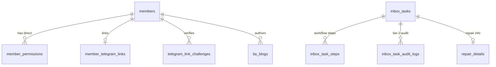
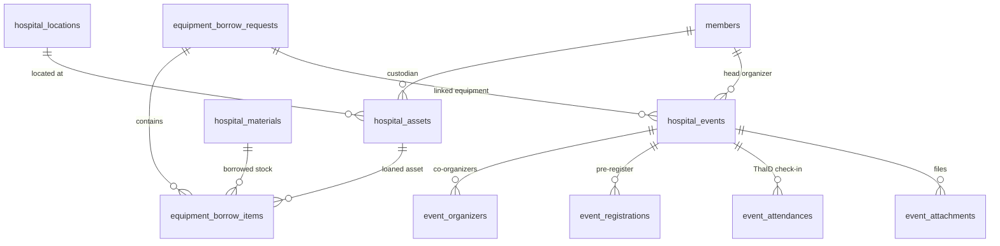
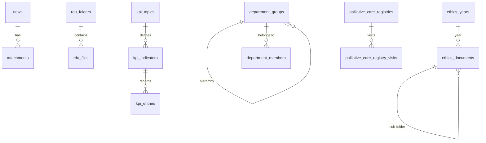

# Database-to-Feature Map — โรงพยาบาลเถิน (Thoen Hospital Website)

เอกสารกลางสำหรับเทียบ **ชื่อตาราง (Table)** ในฐานข้อมูล กับ **ระบบงานและหน้าเว็บ** บนแพลตฟอร์มโรงพยาบาลเถิน  
สามารถเปิดดูแบบ Interactive (ค้นหา / กรองตามระบบ / ดูคอลัมน์และ FK) ได้ที่ [database-map.html](./database-map.html)

---

## 1. ภาพรวมฐานข้อมูลทั้งหมด (ผ่าน Unified API Gateway)

โปรเจกต์ใช้สถาปัตยกรรม **Zero-Database** (Next.js ไม่เปิด Socket ตรงเข้าพอร์ต 3306) โดยเชื่อมฐานข้อมูลทั้งหมดผ่าน `@/lib/apiGateway`:

| ฐานข้อมูล / กลุ่ม | แหล่งนิยามโครงสร้าง | จำนวนตารางหลัก | การเข้าถึงใน Next.js |
|---|---|---|---|
| **Website Core & Member DB (App DB)** | `prisma/schema.prisma` + SQL ใน `fctHomeVisitService.ts` | **45** (Prisma) + **2** (FCT) = **47** | `@/lib/prisma`, `@/lib/memberDb` |
| **RCM & e-Claim DB (`rcmdb`, `eclaimdb`)** | API Gateway (`docs/gateway/routes/rcmFunds.js`) | ~11 ตารางหลัก | `@/lib/clinical/rcmDashboardService` |
| **HOSxP Clinical DB (Read-Only)** | ฐานข้อมูลโรงพยาบาล HOSxP | Read-Only `SELECT` | `@/lib/clinicalDb`, `erDb`, `appointmentDb` |
| **Salary DB** | ฐานข้อมูลเงินเดือน (`192.168.1.4`) | `salary`, `ot`, `datein`, `username` | `@/lib/salaryDb`, `@/lib/salary/*` |
| **Gotowin (GTW) DB** | ฐานข้อมูลพัสดุ Gotowin | `asset_article`, `supplies` | `@/lib/gtwDb`, `@/lib/assets/assetService` |

---

## 2. แผนผังตาราง App DB (47 Tables) แยกตามระบบบนเว็บ

### หมวด 1: ข่าวสารและหน้าแรกเว็บ (Public CMS)
| Table (`@@map`) | Prisma Model | หน้าเว็บหลัก | Service / API | หน้าที่ของตาราง |
|---|---|---|---|---|
| `news` | `News` | `/news`, `/news/[slug]`, `/member/news/news` | `@/app/api/news/**` | หัวข้อข่าว หมวดหมู่ ช่วงวันที่เผยแพร่ และยอดเข้าชม |
| `attachments` | `Attachment` | `/news/[slug]`, `/member/news/news` | `@/lib/storage/documentStorage` | ไฟล์แนบและรูปภาพประกอบข่าว (`news_id` → `news.id`) |
| `hero_slides` | `HeroSlide` | `/`, `/member/news/slides` | `@/app/api/slides/**` | รูปภาพ/วิดีโอ MP4, ลิงก์, ลำดับ และเวลาแสดงสไลด์หน้าแรก |
| `contact_messages` | `ContactMessage` | `/contact` *(ปิดถาวร)* | — | **[DEPRECATED]** ตารางข้อความติดต่อเดิม (ลบ UI/API ออกแล้วตาม `AGENTS.md`) |

### หมวด 2: สมาชิก, การยืนยันตัวตน, สิทธิ์ (RBAC), Telegram & Audit
| Table (`@@map`) | Prisma Model | หน้าเว็บหลัก | Service / API | หน้าที่ของตาราง |
|---|---|---|---|---|
| `members` | `Member` | `/member`, `/member/login`, `/member/member`, `/member/signature` | `@/lib/auth/MemberAuthService` | บัญชีบุคลากรที่ใช้งานได้แล้ว, OTP, รูปโปรไฟล์ และลายเซ็น |
| `member_registrations` | `MemberRegistration` | `/register`, `/member/registrations` | `@/lib/registration/RegistrationService` | คำขอสมัครบุคลากรใหม่รอ Admin อนุมัติก่อนสร้างเข้า `members` |
| `member_system_settings` | `MemberSystemSetting` | `/member/settings` | `@/app/api/member/settings/**` | ค่าตั้งค่าระบบสมาชิกแบบ Key-Value |
| `position_permissions` | `PositionPermission` | `/member/settings` | `@/lib/permissions/taskPermissionService` | สิทธิ์ตามตำแหน่งงาน (Position-based RBAC) |
| `member_permissions` | `MemberPermission` | `/member/settings` | `@/lib/permissions/taskPermissionService` | สิทธิ์รายบุคคล (Member-based RBAC) |
| `member_telegram_links` | `member_telegram_links` | `/member` | `@/lib/telegram/telegramCore` | จับคู่ `member_id` กับ `telegram_chat_id` เพื่อรับแจ้งเตือนบอท |
| `telegram_link_challenges` | `telegram_link_challenges` | `/member` | `@/lib/telegram/telegramCore` | Token ชั่วคราว (One-time Hash) สำหรับยืนยันเชื่อม Telegram |
| `audit_logs` | `AuditLog` | `/member/audit-logs` | `@/lib/audit` | **Tier 1 Audit:** บันทึกการเข้าถึง PHI, สลิปเงินเดือน, Auth, Admin |

### หมวด 3: โครงสร้างองค์กรและกลุ่มงาน
| Table (`@@map`) | Prisma Model | หน้าเว็บหลัก | Service / API | หน้าที่ของตาราง |
|---|---|---|---|---|
| `department_groups` | `DepartmentGroup` | `/about/organization`, `/member/organization` | `@/lib/departments/departmentService` | โครงสร้างกลุ่มงาน/ฝ่ายแบบลำดับชั้น (`parent_id`) |
| `department_members` | `DepartmentMember` | `/about/organization`, `/member/organization` | `@/lib/departments/departmentService` | รายชื่อบุคลากร ตำแหน่ง รูปภาพ และบทบาทในแต่ละกลุ่มงาน |
| `department_roles` | `DepartmentRole` | `/member/organization` | `@/lib/departments/departmentService` | ตัวเลือกบทบาทมาตรฐานในกลุ่มงาน (หัวหน้า, รองหัวหน้า, ผู้ปฏิบัติงาน) |

### หมวด 4: เอกสารราชการ & งานคุณภาพ (ITA / RDU / หนังสือส่งออก / ชมรมจริยธรรม)
| Table (`@@map`) | Prisma Model | หน้าเว็บหลัก | Service / API | หน้าที่ของตาราง |
|---|---|---|---|---|
| `ita_blogs` | `ita_blogs` | `/ita`, `/ita/[slug]`, `/member/ita` | `@/app/api/ita/**` | บทความและรายงานข้อมูลคุณธรรมและความโปร่งใส (ITA) |
| `rdu_folders` | `rdu_folders` | `/rdu`, `/member/rdu` | `@/app/api/rdu/**` | โฟลเดอร์หมวดหมู่เอกสารการใช้ยาอย่างสมเหตุผล (RDU) |
| `rdu_files` | `rdu_files` | `/rdu`, `/member/rdu` | `@/app/api/rdu/**` | รายการไฟล์เอกสาร PDF ในแต่ละโฟลเดอร์ RDU |
| `outgoing_documents` | `OutgoingDocument` | `/service/outgoing-document`, `/member/outgoing-document` | `@/app/api/outgoing-documents/**` | ทะเบียนลิงก์ Google Sheets หนังสือส่งออกรายปีงบประมาณ |
| `ethics_years` | `EthicsYear` | `/ethics`, `/member/ethics` | `@/lib/cms/EthicsDocumentService` | ปีงบประมาณสำหรับจัดหมวดเอกสารชมรมจริยธรรม |
| `ethics_documents` | `EthicsDocument` | `/ethics`, `/member/ethics` | `@/lib/cms/EthicsDocumentService` | โครงสร้างเอกสารแบบ Tree (`parent_id`) ของชมรมจริยธรรม |

### หมวด 5: กล่องงานกลาง, แจ้งซ่อม & ขอผลิตสื่อ
| Table (`@@map`) | Prisma Model | หน้าเว็บหลัก | Service / API | หน้าที่ของตาราง |
|---|---|---|---|---|
| `inbox_tasks` | `Task` | `/member/inbox`, `/member/media-requests`, `/member/repairs/new` | `@/lib/taskInboxService` | ใบคำร้องงานหลัก (`MEDIA_REQUEST`, `IT_REPAIR`, `GENERAL_REPAIR`, `MEDICAL_REPAIR`) |
| `inbox_task_steps` | `TaskStep` | `/member/inbox/[id]`, `.../print` | `@/lib/taskInboxService` | ขั้นตอนอนุมัติ/รับงานแต่ละ Step พร้อมลายเซ็นอิเล็กทรอนิกส์ (Hash) |
| `inbox_task_audit_logs` | `TaskAuditLog` | `/member/inbox/[id]` | `@/lib/taskInboxService` | **Tier 2 Audit:** ประวัติเปลี่ยนสถานะและ Diff การแก้ไขโดยหัวหน้า/ผู้จัดการ |
| `repair_details` | `RepairDetail` | `/member/repairs/new`, `/member/inbox/[id]` | `@/lib/taskInboxService` | รายละเอียดงานซ่อม 3 สายงาน (เลขครุภัณฑ์ สถานที่ ช่าง ส่งซ่อมภายนอก ค่าใช้จ่าย) |

### หมวด 6: สถานที่, ทะเบียนครุภัณฑ์ & ระบบยืม-คืนอุปกรณ์
| Table (`@@map`) | Prisma Model | หน้าเว็บหลัก | Service / API | หน้าที่ของตาราง |
|---|---|---|---|---|
| `hospital_locations` | `HospitalLocation` | `/member/locations` | `@/lib/assets/assetService` | ห้อง/ชั้น/อาคาร (อ้างอิง `LEVEL_ROOM_ID` จาก Gotowin) |
| `hospital_assets` | `HospitalAsset` | `/member/assets`, `/member/equipment-borrow` | `@/lib/assets/assetService` | ทะเบียนครุภัณฑ์, รหัส FSN, ประกัน, ผู้ดูแล และแฟล็ก `is_loanable` |
| `hospital_materials` | `HospitalMaterial` | `/member/equipment-borrow` | `@/lib/equipment/equipmentBorrowService` | คลังวัสดุยืม-คืน (`REUSABLE`) และวัสดุสิ้นเปลือง (`CONSUMABLE`) |
| `equipment_borrow_requests` | `EquipmentBorrowRequest` | `/member/equipment-borrow` | `@/lib/equipment/equipmentBorrowService` | ใบคำขอยืมอุปกรณ์/เบิกวัสดุ (หัวเอกสาร กำหนดคืน สถานะอนุมัติ) |
| `equipment_borrow_items` | `EquipmentBorrowItem` | `/member/equipment-borrow` | `@/lib/equipment/equipmentBorrowService` | รายการย่อยในใบคำขอยืม พร้อมผลการตรวจรับสภาพเมื่อคืน |

### หมวด 7: กิจกรรมโรงพยาบาล & เช็คอิน ThaID
| Table (`@@map`) | Prisma Model | หน้าเว็บหลัก | Service / API | หน้าที่ของตาราง |
|---|---|---|---|---|
| `hospital_events` | `HospitalEvent` | `/member/events`, `/member/events/create`, `/member/events/[id]` | `@/lib/events/hospitalEventService` | ข้อมูลกิจกรรม ช่วงเวลาเปิด-ปิดเช็คอิน QR Token และใบยืมอุปกรณ์ที่ผูกไว้ |
| `event_organizers` | `EventOrganizer` | `/member/events/[id]` | `@/lib/events/hospitalEventService` | รายชื่อผู้รับผิดชอบร่วมของกิจกรรม |
| `event_registrations` | `EventRegistration` | `/member/events/[id]` | `@/lib/events/hospitalEventService` | รายชื่อบุคลากรที่ลงทะเบียนเข้าร่วมล่วงหน้า |
| `event_attendances` | `EventAttendance` | `/member/events/checkin-status`, `/member/events/leaderboard` | `@/lib/events/hospitalEventService` | บันทึกเช็คอิน ThaID QR สำเร็จ (1 คน/งาน) และคะแนนสะสม (Points) |
| `event_attachments` | `EventAttachment` | `/member/events/[id]` | `@/lib/events/hospitalEventService` | ไฟล์เอกสาร รูปภาพ และบันทึกข้อความของกิจกรรม |

### หมวด 8: ระบบคิวคัดกรอง Smart Card
| Table (`@@map`) | Prisma Model | หน้าเว็บหลัก | Service / API | หน้าที่ของตาราง |
|---|---|---|---|---|
| `screening_queues` | `ScreeningQueue` | `/service/screening`, `/service/screening/scan` | `@/lib/screening/screeningService` | คิวผู้รับบริการจากเครื่องอ่านบัตรประชาชน (`WAITING`, `VISIT_OPENED`, `CANCELLED`) |

### หมวด 9: ติดตามตัวชี้วัด KPI & โครงการ/งบประมาณ
| Table (`@@map`) | Prisma Model | หน้าเว็บหลัก | Service / API | หน้าที่ของตาราง |
|---|---|---|---|---|
| `kpi_topics` | `KpiTopic` | `/service/kpi-tracker` | `@/lib/kpi/kpiService` | หมวดหมู่/หัวข้อตัวชี้วัด KPI แยกตามปีงบประมาณ |
| `kpi_indicators` | `KpiIndicator` | `/service/kpi-tracker` | `@/lib/kpi/kpiService` | นิยามตัวชี้วัด เป้าหมาย (Target) ความถี่ และผู้รับผิดชอบ |
| `kpi_entries` | `KpiEntry` | `/service/kpi-tracker` | `@/lib/kpi/kpiService` | ค่าตัวตั้ง ตัวหาร และผลลัพธ์รายงวดของแต่ละตัวชี้วัด |
| `project_tracking_records` | `ProjectTrackingRecord` | `/service/project-tracker` | `@/lib/projects/projectTrackerService` | ทะเบียนโครงการ แผนงบ Q1–Q4 ยอดเบิกจ่ายจริง และสถานะการส่งงาน |
| `project_tracking_meta` | `ProjectTrackingMeta` | `/service/project-tracker` | `@/lib/projects/projectTrackerService` | ค่าตั้งค่า/Meta เสริมของระบบ Project Tracker |

### หมวด 10: ทะเบียนคลินิกเฉพาะทาง (Palliative / DM Remission / FCT)
| Table | แหล่งนิยาม | หน้าเว็บหลัก | Service / API | หน้าที่ของตาราง |
|---|---|---|---|---|
| `palliative_care_registries` | Prisma (`PalliativeCareRegistry`) | `/service/dashboard-rcm/palliative-care/*` | `docs/gateway/routes/palliative.js` | ทะเบียนผู้ป่วยประคับประคอง ICD-10 หลัก/Z51.5 และวันที่ติดตาม |
| `palliative_care_registry_visits` | Prisma (`PalliativeCareRegistryVisit`) | `/service/dashboard-rcm/palliative-care/registry` | `docs/gateway/routes/palliative.js` | วันที่ติดตามเยี่ยมแต่ละครั้ง (Normalized Visit 1..N) |
| `dm_remission_cohorts` | Prisma (`DmRemissionCohort`) | `/service/dm-remission`, `/service/dm-remission/lab-tracking` | `@/lib/clinical/dmRemissionService` | ทะเบียนผู้ป่วยเบาหวานเข้าสู่ระยะสงบ (1 คน/ปีงบประมาณ) + Lab ก่อน-หลัง |
| `dm_remission_options` | Prisma (`DmRemissionOption`) | `/service/dm-remission` | `@/lib/clinical/dmRemissionService` | ตัวเลือก Dropdown ที่ Admin เพิ่มเอง (พฤติกรรม/ผล Remission) |
| `fct_home_visits` | SQL ใน `fctHomeVisitService.ts` | `/service/fct-home-visit` | `@/lib/clinical/fctHomeVisitService` | **[นอก Prisma]** บันทึกการออกเยี่ยมบ้าน 1 ครั้งของทีม FCT 5 วิชาชีพ |
| `fct_home_visit_options` | SQL ใน `fctHomeVisitService.ts` | `/service/fct-home-visit` | `@/lib/clinical/fctHomeVisitService` | **[นอก Prisma]** ตัวเลือก Dropdown ของระบบเยี่ยมบ้าน FCT |

---

## 3. ฐานข้อมูลฝั่ง Gateway และภายนอก (External & RCM Databases)

ระบบบนเว็บที่ **ไม่ได้เก็บข้อมูลลง Prisma App DB** แต่ดึง/กระทบยอดผ่าน API Gateway:

| ฐานข้อมูล | ตาราง / แหล่งข้อมูลสำคัญ | หน้าเว็บที่ใช้งาน | Service / Gateway |
|---|---|---|---|
| **RCM & e-Claim DB** | `rcmdb.t1dm`, `rcmdb.repdata`, `rcmdb.repeclaim`, `rcmdb.neweclaim`, `rcmdb.eclaimstatus`, `rcmdb.authencode`, `rcmdb.nhso_budget`, `rcmdb.seamless`, `rcmdb.seamless_error`, `eclaimdb.m_registerdata`, `eclaimdb.m_serviceother` | `/service/dashboard-rcm/**`, `/service/budget-tracker/**` | `docs/gateway/routes/rcmFunds.js`, `@/lib/clinical/rcmDashboardService` |
| **HOSxP Clinical DB** *(Read-Only)* | `ovst`, `ipt`, `patient`, `opdscreen`, `opitemrece`, `lab_head`, `lab_order`, `er_regist`, `oapp`, `ward`, `spclty`, `doctor` ฯลฯ | `/check-date`, `/service/lab`, `/service/lab-tracker`, `/service/er-in-status`, `/service/ward-status`, `/service/loratadine-dispense`, `/service/tb-cxr-tracker`, `/service/mok`, `/service/dashboard-rcm/**`, `/systems/**` | `@/lib/clinicalDb`, `@/lib/erDb`, `@/lib/appointmentDb` |
| **Salary DB** | `salary`, `ot`, `datein`, `username` | `/salary`, `/member/all-salary`, `/member/upload-salary` | `@/lib/salaryDb`, `@/lib/salary/*`, `docs/gateway/routes/salary.js` |
| **Gotowin (GTW)** | `asset_article`, `supplies` | `/member/assets` (ซิงก์เข้า `hospital_assets`) | `@/lib/gtwDb`, `docs/gateway/routes/gtw.js` |

---

## 4. แผนภาพความสัมพันธ์หลัก (Mermaid ER Diagrams)

### 4.1 ระบบกล่องงานกลาง, แจ้งซ่อม, สมาชิก และสิทธิ์

### 4.2 ระบบครุภัณฑ์, ยืม-คืนอุปกรณ์ และกิจกรรม ThaID

### 4.3 ระบบเอกสาร, KPI และทะเบียนคลินิก

---

## 5. ข้อควรรู้ในการดูแล Schema ระยะยาว

1. **ตารางที่อยู่นอก `prisma/schema.prisma`:** `fct_home_visits` และ `fct_home_visit_options` ถูกสร้างผ่าน `CREATE TABLE IF NOT EXISTS` ใน `src/lib/clinical/fctHomeVisitService.ts` — หากต้องการให้ Prisma Client รู้จักในอนาคต สามารถเพิ่ม Model ลงในหมวด 10 ของ `prisma/schema.prisma` ได้
2. **ตารางที่เลิกใช้งานแล้ว:** `contact_messages` ยังคงอยู่ใน Schema แม้จะถอดฟีเจอร์ `/contact` ออกแล้วตาม `AGENTS.md`
3. **กติกาตั้งชื่อ Table ใหม่:** ควรใช้ Prefix ของระบบนำหน้าเสมอ (เช่น `kpi_*`, `event_*`, `dm_remission_*`, `fct_home_visit*`) เพื่อให้ตารางของระบบเดียวกันเรียงต่อกันในเครื่องมือจัดการ DB
