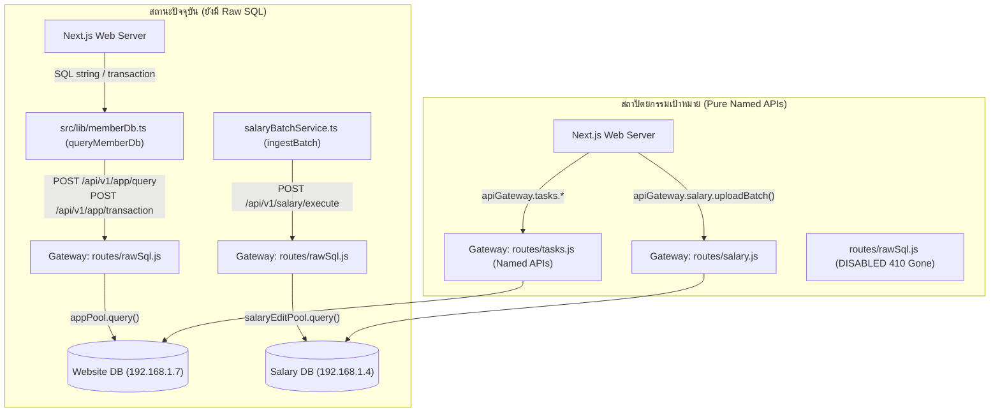

# แผนงานการย้ายระบบ Task Inbox, Legacy CMS สู่ Named APIs และปิดตาย Raw SQL Endpoints
**Project:** Thoen Hospital Information System & Unified API Gateway  
**Domain:** Task Inbox, Repairs, Legacy CMS & Raw SQL Deprecation  
**Status:** Ready for Execution (เตรียมพร้อมดำเนินการ)  
**Target Server:** API Gateway VM (`192.168.1.208:8443`), Web Server (`Next.js 16+ Turbopack`)  

---

## 1. บทนำและเป้าหมายเชิงสถาปัตยกรรม (Architectural Objectives)

ปัจจุบันเว็บไซต์โรงพยาบาลเถินได้บรรลุสถาปัตยกรรม **100% Zero-Direct-DB** โดยไม่มีการเปิด MySQL socket (Port 3306) จากเครื่องเว็บไปยังฐานข้อมูลโดยตรง ทุกการเข้าถึงทำผ่าน **Thoen Hospital Unified API Gateway** (`http://192.168.1.208:8443`)

อย่างไรก็ตาม ในขั้นตอนก่อนหน้านี้ ระบบยังคงมีการส่งคำสั่ง Raw SQL ข้ามเครือข่ายผ่านช่องทางฉุกเฉิน (Quarantined Raw SQL Endpoints):
1. `POST /api/v1/app/query` (สำหรับคำสั่ง `SELECT`)
2. `POST /api/v1/app/execute` (สำหรับคำสั่ง `INSERT`, `UPDATE`, `DELETE`)
3. `POST /api/v1/app/transaction` (สำหรับ Atomic Batch Transactions)
4. `POST /api/v1/salary/execute` (สำหรับคำสั่งแก้ไขใน Salary DB)

### เป้าหมายหลักของแผนงานนี้:
1. **Decoupled Data Architecture:** ย้ายชุดคำสั่ง SQL ดิบทั้งหมดในระบบ Task Inbox, ระบบงานช่าง/แจ้งซ่อม, งานสื่อประชาสัมพันธ์ และ CMS เก่า เข้าสู่ **Gateway Named APIs** เฉพาะทางที่มี Business Validation ชัดเจน
2. **Eliminate SQL Injection Risk 100%:** กำจัดการส่ง SQL String ผ่าน HTTP Payloads โดยสิ้นเชิง
3. **Thin Route Adapters Standard:** ปรับ API routes ใน `src/app/api/**` ให้เป็นเพียง Thin Adapter (~20–40 บรรทัด) ไม่มี Raw SQL Query อยู่ภายใน route ตามเกณฑ์ `AGENTS.md`
4. **Permanent Raw SQL Disable:** ปิดตาย (Disable) Endpoint ทั้ง 4 ตัวใน `routes/rawSql.js` โดยตอบกลับด้วย `HTTP 410 Gone` หรือ `HTTP 403 Forbidden` พร้อม Re-deploy ขึ้น Gateway VM `192.168.1.208` ผ่าน SSH/Paramiko (`/ssh-thlp`) แบบ Zero-Downtime

---

## 2. การสำรวจระบบปัจจุบันและสิ่งที่ยังค้างอยู่ (Current State & Gap Analysis)



### 2.1 Task Inbox & Repairs (`src/lib/taskInboxService.ts`)
- **จำนวนจุดเรียกใช้:** มีการเรียกใช้ `queryMemberDb` / `executor` ถึง **64 จุด**
- **ตารางที่เกี่ยวข้อง:** `inbox_tasks`, `inbox_task_steps`, `inbox_task_audit_logs`, `repair_details`, `members`, `position_permissions`, `member_telegram_links`
- **ฟังก์ชันสำคัญที่ต้องแปลงเป็น Named APIs:**
  1. `generateTaskNo(taskType)`: ออกเลขที่ใบงานตามปีงบประมาณไทย (เช่น `IT-2570-10-0001`)
  2. `executeWorkflowAction(params)`: อนุมัติ / ตีกลับ / ดำเนินการตามขั้นตอน, คำนวณ HMAC-SHA256 Stamp, เลื่อน Step และบันทึก Audit Log
  3. `executeRepairAction(params)`: ช่างรับงาน / กำลังซ่อม / ซ่อมเสร็จ / รออะไหล่ พร้อมอัปเดตอะไหล่และค่าใช้จ่าย
  4. `updateTaskByManager(params)`: การแก้ไขข้อมูลโดยหัวหน้างาน พร้อม Diff Tracking และบันทึก Audit Log
  5. `getInboxTasks(filters)` & `getInboxTaskById(id)`: ดึงข้อมูลรายการงาน, Step ประวัติการอนุมัติ, ข้อมูลงานซ่อม และ Audit Logs ในคำขอเดียว

### 2.2 Salary Batch Ingestion (`src/lib/salary/salaryBatchService.ts`)
- ฟังก์ชัน `ingestBatch` ยังคงลูปเรียก `querySalaryEditDb` (ซึ่งยิงเข้า `/api/v1/salary/execute`) ทีละแถว
- Gateway มี `POST /api/v1/salary/upload-batch` เตรียมไว้แล้ว เพียงแค่สลับ Next.js ให้เรียก `apiGateway.salary.uploadBatch(batch.targetTable, batch.rows)`

### 2.3 Legacy CMS & บริการย่อยที่ยังเรียก `queryMemberDb`
- **ITA Blogs:** `src/app/api/ita/blogs/route.ts` & `[id]/route.ts`
- **RDU (ยา):** `src/app/api/rdu/route.ts`, `src/app/api/member/rdu/*`
- **Outgoing Documents:** `src/app/api/member/outgoing-document/route.ts`
- **Departments & Locations:** `src/lib/departments/departmentService.ts`, `src/app/api/locations/route.ts`
- **Screening:** `src/lib/screening/screeningService.ts`
- **Signatures:** `src/app/api/signatures/route.ts`

---

## 3. รายละเอียดการออกแบบ Named APIs บน Gateway

### 3.1 สร้าง Fastify Plugin ใหม่: `docs/gateway/routes/tasks.js`
(หรือรวมลงใน `routes/app.js` แต่แยกเป็น `routes/tasks.js` เพื่อความ Clean และเป็นโมดูลย่อยชัดเจน)

| HTTP Method | เส้นทาง (Endpoint) | หน้าที่การทำงาน | Payloads / Parameters |
| :--- | :--- | :--- | :--- |
| `POST` | `/api/v1/app/tasks/generate-no` | สร้างเลขที่ใบงานถัดไปตามปีงบประมาณไทย | `{ taskType: string }` |
| `GET` | `/api/v1/app/tasks/inbox` | ดึงรายการงานตาม Filter (แท็บ, ประเภท, สิทธิ์, แผนก) | `?tab=inbox&type=...&memberId=...&limit=...` |
| `GET` | `/api/v1/app/tasks/:id/full-details` | ดึงรายละเอียด Task, Steps, Repair, Audit Logs ครบใน 1 atomic query | `id: number` |
| `POST` | `/api/v1/app/tasks/create` | สร้างใบงานใหม่พร้อม Initial Steps และ Repair Details (ถ้ามี) | Payload ใบงานตามแต่ละประเภท |
| `POST` | `/api/v1/app/tasks/workflow-action` | ทำการ Transition State ของ Workflow (APPROVE, REJECT, SEND_BACK) | `{ taskId, action, member, comment, signatureHash, ... }` |
| `POST` | `/api/v1/app/tasks/repair-action` | บันทึกการดำเนินงานซ่อมของช่าง | `{ taskId, action, member, repairDetails, ... }` |
| `PUT` | `/api/v1/app/tasks/:id/manager-edit` | บันทึกการแก้ไขข้อมูลโดยหัวหน้างาน พร้อม diff tracking | `{ taskId, member, updates, diffSummary }` |
| `GET` | `/api/v1/app/tasks/assignees` | ดึงรายชื่อสมาชิกที่มีสิทธิ์รับมอบหมายงานตามแผนก/บทบาท | `?taskType=...&stepNo=...` |

### 3.2 ปรับปรุง `src/lib/apiGateway.ts` (Next.js Gateway Client)
เพิ่มหมวดหมู่ `tasks` ภายใต้ `apiGateway.tasks` หรือ `apiGateway.app.tasks`:
```typescript
public readonly tasks = {
  generateNo: (taskType: string) => 
    this.post<{ taskNo: string }>('/api/v1/app/tasks/generate-no', { taskType }),
  
  getInbox: (params: TaskListParams) => 
    this.get<{ items: InboxTaskSummary[]; total: number }>(`/api/v1/app/tasks/inbox${toQueryString(params)}`),
  
  getFullDetails: (taskId: number | string) => 
    this.get<FullTaskDetails>(`/api/v1/app/tasks/${taskId}/full-details`),
  
  createTask: (data: CreateTaskPayload) => 
    this.post<{ insertId: number; taskNo: string }>('/api/v1/app/tasks/create', data),
  
  executeWorkflowAction: (data: WorkflowActionPayload) => 
    this.post<WorkflowActionResult>('/api/v1/app/tasks/workflow-action', data),
  
  executeRepairAction: (data: RepairActionPayload) => 
    this.post<RepairActionResult>('/api/v1/app/tasks/repair-action', data),
  
  updateByManager: (taskId: number | string, data: ManagerEditPayload) => 
    this.put<{ success: boolean; affectedRows: number }>(`/api/v1/app/tasks/${taskId}/manager-edit`, data),
}
```

---

## 4. ขั้นตอนการดำเนินงาน 4 ระยะ (Phase Execution Plan)

### ระยะที่ 1: จัดการ Salary Execute Deprecation (เร็วและปิดความเสี่ยงทันที)
- [ ] **1.1 ปรับ `src/lib/salary/salaryBatchService.ts`:**
  - เปลี่ยนฟังก์ชัน `ingestBatch` ให้เรียก `apiGateway.salary.uploadBatch(batch.targetTable, batch.rows)`
- [ ] **1.2 ตรวจสอบ `src/lib/salary/salaryLedgerService.ts`:**
  - ยืนยันว่าไม่มีจุดใดเรียก `querySalaryEditDb` ซ้ำซ้อน
- [ ] **1.3 รัน Unit Tests:**
  - ตรวจสอบชุดทดสอบ `npm test src/lib/salary` ให้ผ่าน 100%

### ระยะที่ 2: สร้าง Named APIs รองรับ Task Inbox & Repairs
- [ ] **2.1 สร้างโมดูล `routes/tasks.js` บน Gateway (`docs/gateway/routes/tasks.js`):**
  - นำ Logic SQL จาก `taskInboxService.ts` ย้ายไปเป็น Atomic Prepared Statements บน Fastify Gateway
  - รองรับ Transaction ปลอดภัย (`SET NAMES utf8mb4`) เพื่อป้องกันภาษาไทยต่างดาว
- [ ] **2.2 เพิ่ม SDK Methods ใน `src/lib/apiGateway.ts`:**
  - สร้าง Interfaces & Methods รองรับทุก Endpoint ของ Tasks
- [ ] **2.3 Refactor `src/lib/taskInboxService.ts`:**
  - ปรับปรุงให้เรียกใช้ Gateway SDK เป็นหลัก
  - คง Dependency Injection (`QueryExecutor`) ไว้สำหรับการรัน Vitest Mocking ให้ผ่าน 100%
- [ ] **2.4 ปรับ Route Handlers ให้เป็น Thin Adapters:**
  - `src/app/api/member/inbox/route.ts`
  - `src/app/api/member/inbox/[id]/route.ts`
  - `src/app/api/member/inbox/[id]/action/route.ts`
  - `src/app/api/member/inbox/[id]/repair-action/route.ts`
  - `src/app/api/member/repairs/route.ts`
  - `src/app/api/member/media-requests/route.ts`
- [ ] **2.5 ทดสอบ Unit Tests:**
  - รัน `npm test src/lib/__tests__/taskInboxService.action.test.ts` และการทดสอบสิทธิ์ทั้งหมด

### ระยะที่ 3: สำรวจและย้าย Legacy CMS / Peripheral Services ที่เหลือ
- [ ] **3.1 ระบบเอกสารภายนอก (Outgoing Documents):**
  - สร้าง Named API หรือแปลงเข้า Service
- [ ] **3.2 ระบบ ITA Blogs & ข้อมูล RDU:**
  - แปลง SQL ใน `src/app/api/ita/*` และ `src/app/api/rdu/*` ไปยัง Named API
- [ ] **3.3 ระบบ Departments & Locations:**
  - ปรับปรุง `departmentService.ts` และ `locations/route.ts`
- [ ] **3.4 ยืนยันความพร้อม:**
  - รันคำสั่ง `git grep queryMemberDb src/` เพื่อยืนยันว่าไม่มีโค้ดส่วนใดในเว็บเรียก Raw SQL แล้ว

### ระยะที่ 4: ปิดตาย (Disable) Raw SQL บน Gateway และ Deploy ผ่าน `/ssh-thlp`
- [ ] **4.1 ปรับปรุงไฟล์ `routes/rawSql.js`:**
  - แก้ไข Handler ของ `/api/v1/app/query`, `/execute`, `/transaction` และ `/api/v1/salary/execute` ให้ตอบกลับ:
    ```javascript
    reply.code(410).send({
      success: false,
      error: 'Endpoint Deprecated: Raw SQL access has been permanently disabled. Use specialized Named APIs.'
    })
    ```
- [ ] **4.2 เชื่อมต่อ API Gateway VM (`192.168.1.208:thoen`) ผ่าน SSH/Paramiko:**
  - อัปโหลดไฟล์ `routes/tasks.js`, `routes/app.js`, `routes/rawSql.js`, `server.js` ขึ้นเซิร์ฟเวอร์
- [ ] **4.3 Pre-flight Syntax Check:**
  ```bash
  docker exec thoen-api-gateway node --check /app/server.js
  docker exec thoen-api-gateway node --check /app/routes/tasks.js
  docker exec thoen-api-gateway node --check /app/routes/rawSql.js
  ```
- [ ] **4.4 รีสตาร์ต Gateway และ Health Check:**
  ```bash
  docker restart thoen-api-gateway && sleep 2 && curl -s http://127.0.0.1:8443/health
  ```
- [ ] **4.5 E2E Verification:**
  - ทดสอบสร้างงานซ่อม, อนุมัติงานใน Inbox, ดูสลิปเงินเดือน และเปิดหน้าเว็บหลัก

---

## 5. แผนการสำรองและการย้อนกลับ (Rollback & Safe Switch Protocol)

1. **Pre-deploy Backup บน VM:**
   - ทำสำเนาโฟลเดอร์ `routes/` เดิมบน Gateway VM ไว้ที่ `/home/thoen/thoen-api-gateway/routes.bak_YYYYMMDD` ก่อนทำการแก้ไขเสมอ
2. **Graceful Fallback Mode:**
   - ในระยะแรก (Phase 2), Service ใน Next.js จะตรวจสอบหาก Named API ส่งกลับ 404 หรือ 501 สามารถ Fallback ได้ชั่วคราวก่อนที่จะปิดตาย Raw SQL ใน Phase 4
3. **Rollback Action:**
   - หากตรวจพบความผิดปกติหลังปิดตาย Raw SQL สามารถ Revert `routes/rawSql.js` เดิมกลับและสั่ง `docker restart thoen-api-gateway` ได้ภายใน 3 วินาที

---

*เอกสารฉบับนี้พร้อมใช้เป็น Checklist ในการพัฒนาและอ้างอิงขั้นตอนร่วมกับคำสั่ง `/ssh-thlp`*
